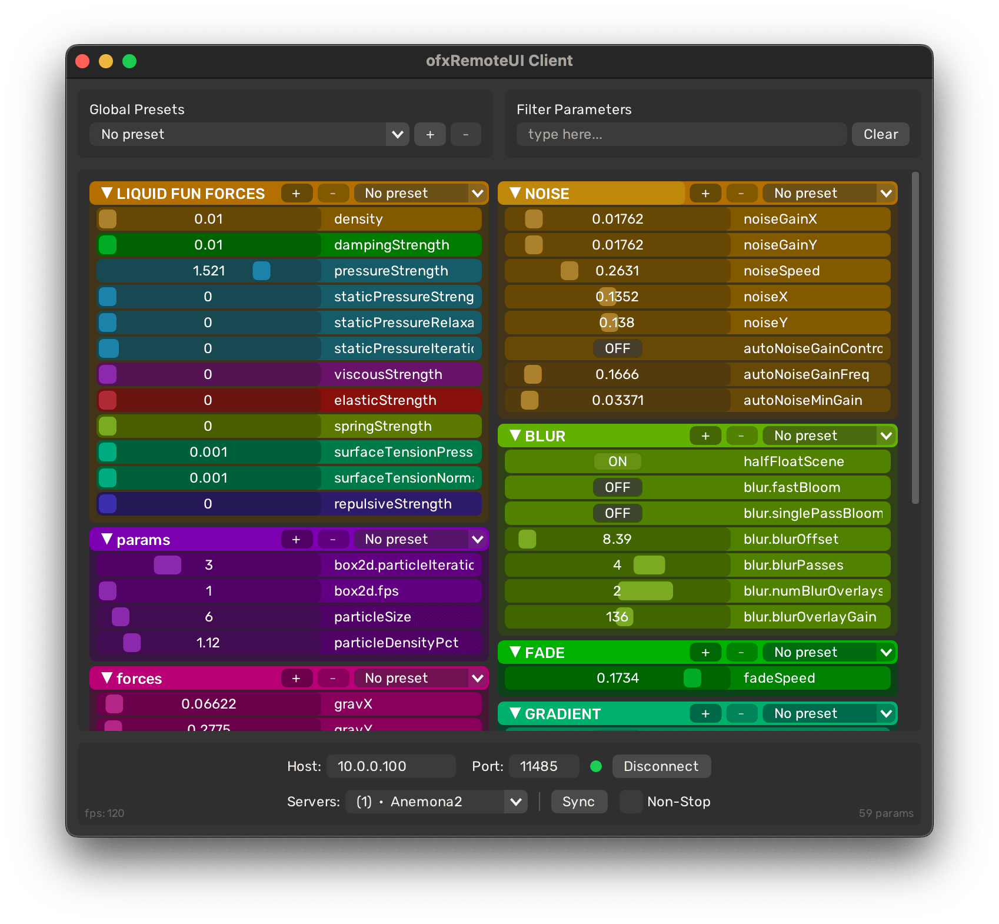
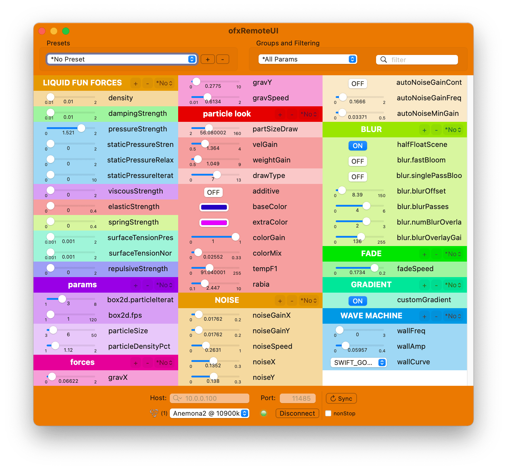
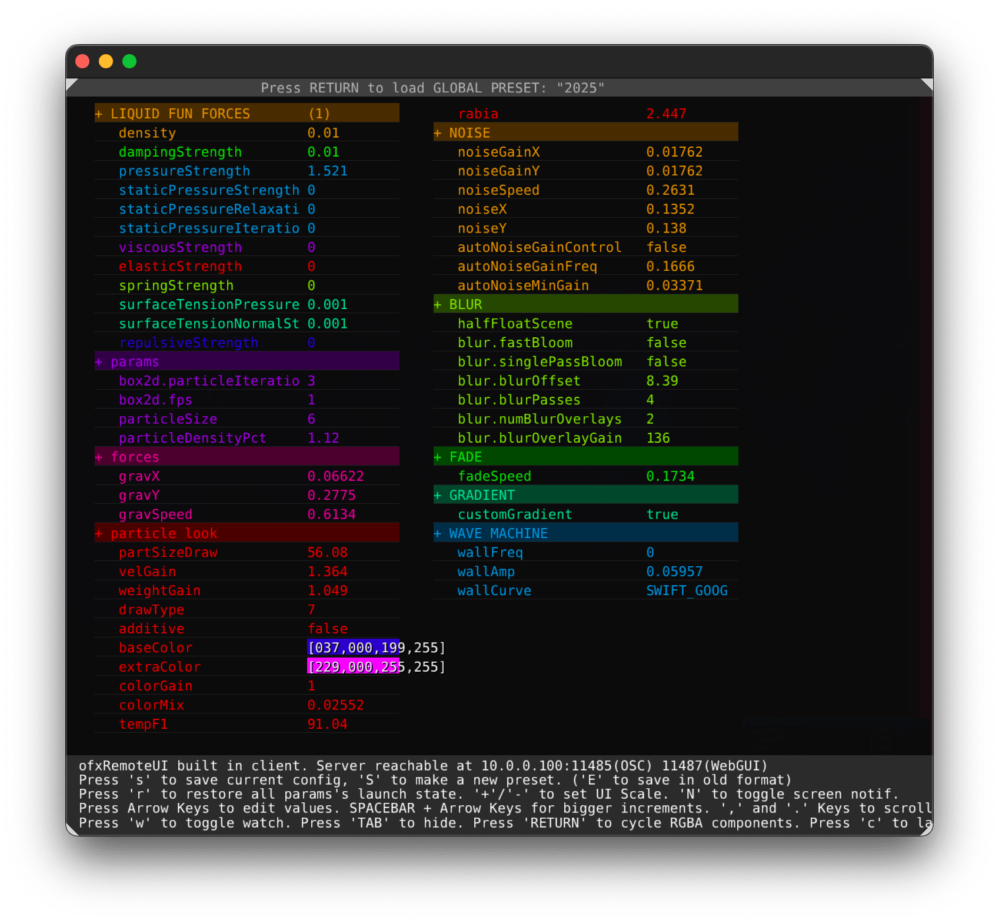
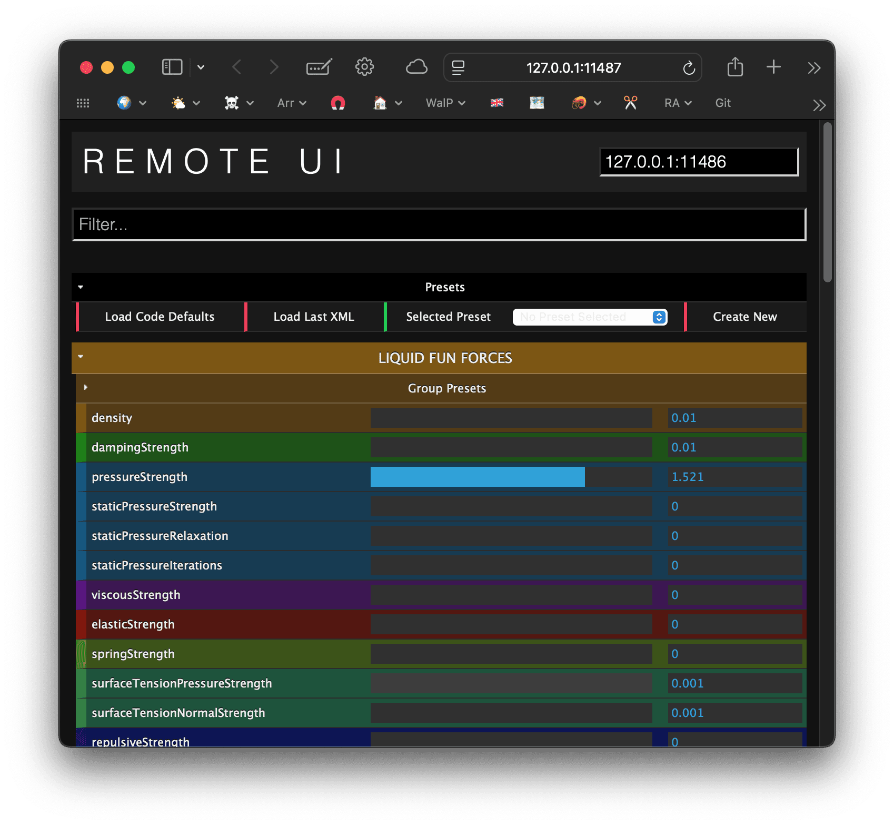
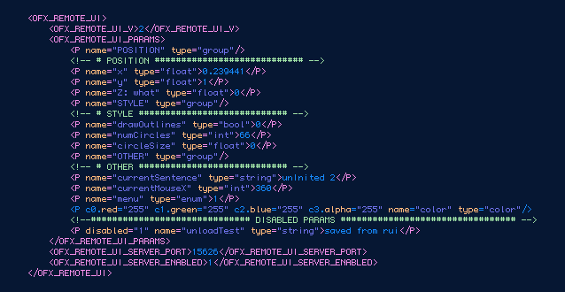

# ofxRemoteUI

OpenFrameworks addon that allows you to serve c++ variables/parameters (bool, float, int, enum, string, ofColor) on the network, so that you can modify them remotely. It uses server client architecture, where your app is the server. It communicates both ways; you can modify your project's variables from the client, but you can also pull your app's variable values from the client; this way you can track values that evolve programatically. It runs on OSC.

You can save and then load "presets", which allow you to quickly change values for a lot of your parameters quickly. You can also make "group presets" to change only the values of a subset of your parameters.

__Compile against OF master branch. If you are trying to use this
against an older version (0.9.8 or lower) you should use the commit tagged
with "OF_0.9.8". It requires ofxPoco in OF versions >0.9.8__


Watch a quick [Intro Video](http://youtu.be/F18f67d_WjU).

  
  
  
  

In order of appearance in the screenshot above, Mac OS X native Client, ImGui Client (multiplatform), Built In Client (inside your OpenFrameworks app, keyboard operated only), Web Client (served from your OpenFrameworks app).

---

## Features

* Edit & Track variables remotely through UDP/OSC (bool, int, float, string, Enum, ofColor).
* Share float, int, and bool parameters through C++ getters and setters.
* Allows to save/load your variable states across app launches.
* MIDI and Joystick controller bindings. Bind any parameter to any MIDI controller knob/slider/note or HID Joystick. (OSX Client)
* Parameter values are saved in your app's data folder, in xml format.
* Allows creation/deletion of Presets, variable states that you can switch from and to quickly.
* Presets can be created globally (saving all parameter values at once), or for a subset of params (param group).
* Easily create Parameter Groups, and access them through keyboard shortcuts (OSX Client).
* Parameter Groups are automatically colorized to easily identify them.
* Realtime Filter your params by name to find things quickly (OSX Client).
* Automatic discovery of servers in the network; easily control multiple apps from one Client interface.
* Press "tab" on your OF app to see/edit your params from within your OF app. Allows you to do quick client-less edits; and also load and save Global and Group Presets.
* Event notifications in both OSX client (through growl) and on your OF app.
* You can always restore your parameters to the "previous launch" state, or to the default values.
* Log remotely - ofxRemoteUIServer allows you to log messages to you client with RUI_LOG(); which accepts printf-like formatted writing.
* ofxRemoteUI can be used outside OF in any C++ project, and in Processing thx to [@kritzikratzi](http://github.com/kirtzikratzi)
* Easy to use C++ Macros hide complexity away, very easy to plug into any existing project.
* Support for native ofParameters of compatible types (int, float, bool, string ofColor, ofVec). Allows you to edit native OF ofParameter types from RemoteUI. See "example-ofParameter". *outdated!
* Control parameters from any web browser through its web gui.
* Proper multiplatform client based on the awesome [Dear ImGui](https://github.com/ocornut/imgui) (thanks to chatGPT).

## Dependencies

* ofxXmlSettings
* ofxOsc
* ofxPoco in OperFrameworks version > 0.9.8

## Available Clients

* Native OSX client, feature complete (this should be your first choice on OSX)
* ImGui client (`ImguiClient`): a standalone client with all the features of the original OSX client. The macOS build has been tested; Windows and Linux builds still need verification.
* Built in client (inside the OF app) for basic edits, saving, resetting, and global and group preset loading and saving.
* WebClient based on [dat.GUI](https://github.com/dataarts/dat.gui). Connect to OpenFrameworks through websockets (thx to [@jackosx](http://github.com/jackosx)).


## Compatibility

Works in OpenFrameworks, but also in plain C++ projects.
[@kitschpatrol](http://github.com/kitschpatrol) developed a Cinder Block based on a fork of ofxRemoteUI that also supports getter/setter bindings. [Cinder-RemoteUI](https://github.com/kitschpatrol/Cinder-RemoteUI)

There's also a feature limited version of the server for Processing, made by [@kritzikratzi](http://github.com/kirtzikratzi)! See <a href="http://superduper.org/processing/remoteUI">here</a>.

## Motivations

I know there's tons of very good UI's already, but one thing that bothers me about most of them is how by using them, your are affecting your framerates quite a lot. That's the main reason that made me build ofxRemoteUI. Being quite comfy in OSX development, I chose to make a full-featured native OSX client; although clients for other platforms could be developed as well, using the underlying ofxRemoteUIClient class.

## Details

It's OSC based, and it includes a native OSX Client. The Native OSX Client allows param colorization for better clarity, and live param filtering. It also supports the grouping of params into categories, for easy access. There's automatic keyboard shortcuts to do so.

It can also be set to store the current values when quitting the app (or whenever its convenient), so that you can carry on where you left off last time you used it. It does so by saving a file called "ofxRemoteUISettings.xml" in your data folder. It uses ofxXmlSettings to store everything.

You can also create and delete presets, which are parameter states for your app. Presets are stored with your OF app, inside an "ofxRemoteUIPresets" folder, in your data folder. This makes it easy to check in your presets with your source code. Whenever you like the current config, you can make a preset to keep it around. You can also delete presets.

ofxRemoteUI uses Macros + the singleton pattern to make it very easy to share any variable you decide to edit remotely, from any class of your project.

The OSX client also allows to copy all the current params as plain text. You can also paste them back after editing them! Thx to @kritzikratzi for this idea!

To use it outside of OpenFrameworks, you can see how the example-noOF is setup.   

-----


## How To Use

the most basic setup only requires a few calls.

	float x;
	int y;
	ofColor color;

	void setup(){

		RUI_SETUP(); //start server

		//Expose x and y vars to the server, providing a valid slider range
		RUI_SHARE_PARAM(x, 0, ofGetWidth());
		RUI_SHARE_PARAM(y, 0, ofGetHeight());

		//share the color param
		RUI_SHARE_COLOR_PARAM(color);

		//load values from XML, as they were last saved (if they were)
		RUI_LOAD_FROM_XML();
	}

Then, use any of the client options to view and edit your shared parameters.
Look into the server example to see more features. It is fairly documented.

Parameter names are unique across the server, including across groups. `shareParam()` and the `RUI_SHARE_PARAM` macros return `true` when registration succeeds. A duplicate logs an error, returns `false`, and leaves the existing parameter in place. Use `RUI_SET_PARAM_BINDING` to change an existing parameter's binding.


### Watch parameters on the server screen

In the built-in client, select a parameter and press **w** to toggle its watch; `*` marks watched parameters. In the ImGui and native macOS clients, right-click a parameter label and choose **Watch on server screen**. A star identifies watched parameters; choose the same menu item to stop watching. Use **RemoteUI → Remove All Watches** to clear the entire list. The server sends its watch list when the client syncs and when watches change. Save the current state using the normal save command to persist watches in the `.rui` file. Loading a full `.rui` file with watch metadata restores the list; older files without it leave the current list alone. Group presets do not change watches. On-screen watches require the server application to draw RemoteUI notifications.

Clients can use `setParamWatched(name, bool)` and `isParamWatched(name)`. Over OSC, `/WATC` takes a string parameter name and an int32 (1 to watch, 0 to unwatch). `/WCLR` removes all watches; `/WATL` requests the list; the server also sends `/WATL` with zero or more string arguments containing the complete list after a change or full sync. As with other RemoteUI changes, save the server state to persist it.

### Share a parameter with a getter and setter

Use `RUI_SHARE_PARAM("Display name", getter, setter, ...)` when a value lives behind a method, needs unit conversion, or requires work when it changes. Pass a getter that takes no arguments and returns the current value, then a setter that takes the new value. Use a getter that returns `float` or `int` by value and pass the slider's minimum and maximum after the setter. For `bool`, omit the range. Each form also accepts an optional background color as its last argument.

`RUI_SHARE_PARAM_WCN` also accepts a name followed by the callbacks. Use `RUI_SHARE_PARAM_DESC` to put a description between the name and the getter. The same callbacks can be passed directly to `ofxRemoteUIServer::shareParam`.

The server example stores animation speed as a multiplier and displays it as a percentage. Its resolution setter updates the renderer. Include `ofxRemoteUIServer.h` and register the bindings after `RUI_SETUP()` inside `ofApp::setup()`.

```cpp
// ofApp members are initialized to animationSpeed = 1.0f,
// circleResolution = 32, and animateCircles = true.
RUI_NEW_GROUP("GETTERS AND SETTERS");

RUI_SHARE_PARAM("Animation speed (%)",
    [this] { return animationSpeed * 100.0f; },
    [this](float percent) { animationSpeed = ofClamp(percent, 0.0f, 200.0f) / 100.0f; },
    0.0f, 200.0f);

RUI_SHARE_PARAM_DESC("Circle resolution", "Number of segments used to draw each circle.",
    [this] { return circleResolution; },
    [this](int resolution) {
        circleResolution = ofClamp(resolution, 3, 128);
        ofSetCircleResolution(circleResolution);
    },
    3, 128);

RUI_SHARE_PARAM_WCN("Animate circles",
    [this] { return animateCircles; },
    [this](bool enabled) { animateCircles = enabled; });
```

Remote edits and preset loads go through the setter when the requested value differs from the current value. The server reads the getter again after a change so it records the value actually accepted. Keep any validation your app requires in the setter. Presets save the getter's current value, and **Restore to Default Values** uses the value read when the binding was registered. If your app changes a value directly, use `RUI_PUSH_TO_CLIENT()` to sync connected clients.

Callbacks run synchronously on the thread that reads or updates the parameter. Keep captured objects alive while the parameter is shared. For an object that can go away while the server is running, call `RUI_GET_INSTANCE()->removeParamFromDB("Parameter name", true)` before destroying it. Keep getters free of side effects, and keep both callbacks short, non-throwing, and free of calls back into RemoteUI. If you use `RUI_START_THREADED()`, synchronize access to shared state and hand off renderer work to the main thread.

Run the example and open **GETTERS AND SETTERS** in your client, or press **Tab** in the app to use the built-in UI. Set **Animation speed (%)** to 50 for half speed, adjust **Circle resolution** to change how smooth the circles look, or toggle **Animate circles** to pause and resume their motion. [Server example](example-server/src/ofApp.cpp)


### Replace a binding at runtime

Use `RUI_SET_PARAM_BINDING` or `ofxRemoteUIServer::setParamBinding` to replace both callbacks on an existing float, int, or bool. This also works if the parameter was originally shared by pointer. Pass its registered name and callbacks of the same type.

```cpp
// The existing "Animation speed (%)" parameter expects a float in percent.
if (RUI_SET_PARAM_BINDING("Animation speed (%)",
        [this] { return activeScene.getSpeed() * 100.0f; },
        [this](float percent) { activeScene.setSpeed(percent / 100.0f); })) {
    RUI_PUSH_TO_CLIENT();
}
```

The new getter supplies the live value immediately. The setter runs on the next edit or reset that changes the value. The name, group, range, and original reset values are preserved. Use `RUI_PUSH_TO_CLIENT()` to send the new value to connected clients. The call returns `false` for an unknown name, a type mismatch, or an empty callback.


## Controller Bindings
The ofxRemoteUI OSX client allows to bind any midi control / joystick axis / button to any of your params. Make sure your device is connected before you launch the app. To bind a device to a parameter, do the following:

1. Click on a param name on the main Window. It will start blinking.
2. Rotate/Slide/Press your external device control (joystick, gamepad button, midi slider, knob, etc).
3. Done! You can now control that param from your external controller

You can Save/Load/Edit/Clear your midi bindings from the "MIDI Bindings" window.

MIDI Sliders/Knobs/etc can be bound to floats, ints, enums, bools and colors. For ints, floats and enums, the mapping is obvious; for bools, the lower half of a slider/knob sets the param to false, the upper half to true. For colors, the slider shifts the hue of the color parameter.

Bools can also be bound to "piano keys"; params being set to true for as long as a key is held down.

Bindings are saved when the app is quit. You can also save any particular device binding configuration into a ".midiBind" file. You can also double-click any .midiBind file form the finder to load your previously saved bindings. There is a "bindings" window that allows you to delete particular bindings. You can see what parameters are currently bound by choosing "File->Blink Bound Midi Controls".

## Dear ImGui client

This tries to mirror the original OSX client 1:1.  
  
To build it:

1. Install this addon as `openFrameworks/addons/ofxRemoteUI` and install [ofxMidi](https://github.com/danomatika/ofxMidi) as `openFrameworks/addons/ofxMidi`. 
2. Open Project Generator and select the addon's `ImguiClient` directory as the project. The included `addons.make` selects `ofxRemoteUI` and `ofxMidi`; the addon's dependencies include `ofxOsc`, `ofxPoco` and `ofxXmlSettings`. The included `config.make` points Project Generator at the client-only Dear ImGui sources in `../libs/imgui`.
3. Generate the project for your platform, then open and build the generated project. Keep `ImguiClient/bin/data/fonts` with the application so it can load its fonts. For a generated Xcode project, add a Run Script build phase before Compile Sources that runs `"$SRCROOT/update-build-commit.sh"` and disable dependency analysis for that phase. This embeds the addon Git commit shown in About; Make builds refresh it automatically. Builds without Git metadata show `unknown`.
4. On macOS, retain the provided `openFrameworks-Info.plist` when generating the Xcode project (or restore it afterward) for Retina support and Finder's `.rui` Open With entry. 

The generated build should compile the Dear ImGui core, `imgui_demo.cpp` (used by the style editor), and the GLFW and OpenGL3 backends from `libs/imgui`. These sources are excluded from ordinary `ofxRemoteUI` addon builds to avoid conflicts with an application's own ImGui version. A standalone macOS distribution must also include the data folder; Project Generator's default app build does not bundle it automatically.


## Web-based Interface

The web client allows you to control the parameters of your OpenFrameworks app from a web browser. It does so by connecting your web browser to your OF app through websockets; it uses ofxPoco to handle the connection.

ofxRemoteUIServer creates a minimal webserver that hosts a single-file HTML + JS + CSS gzipped package that your browser will interpret. You don't need to provide additional files.

You can quickly load up the web GUI interface by getting into the built-in client (press 'tab' from the OF app), and from there press 'c' (for client). This will launch a web browser and load the web gui for you.

The web interface is developed in a separate repository [ofxRemoteUI-Web](https://github.com/armadillu/ofxRemoteUI-Web). The whole interface is packaged in the [RUIWebBinary.cpp](https://github.com/armadillu/ofxRemoteUI/blob/master/src/RUIWebBinary.cpp) file, so if you want to modify / tweak the interface, go to the [ofxRemoteUI-Web](https://github.com/jackosx/ofxRemoteUI-Web) repo and create a new build of that file and drop it into the ofxRemoteUI src folder (replacing the old one).

The web client has completely been developed by [@jackosx](http://github.com/jackosx), with some quality-of-life tweaks by [@armadillu](http://github.com/armadillu).

Note that this interface is not very tested. Don't use several clients at the same time, only one will be allowed to connect. Web client connection/disconnection doesnt seem very realiable at the moment, but should be ok for a quick edit. You can completely disable the web interface by defining the preprocessor macro "NO_RUI_WEB_INTERFACE" in your project. 


## OSC Query and Vezér

On macOS, ofxRemoteUI can advertise an OSC Query server so applications such as [Vezér](https://imimot.com/blog/vezer-1-7-released/) can discover the parameters shared by your app and create OSC tracks for them. The server publishes a JSON description of the current parameters, grouped as in RemoteUI, including their OSC addresses, types and available ranges. It supports floats, integers, enums, booleans, colors and strings. The exact track types supported depend on the client.

OSC Query is optional and disabled by default. To enable it, add `RUI_ENABLE_QUERYSERVER=1` to your **application target's** preprocessor definitions.

This feature currently requires an openFrameworks macOS build, ofxPoco, and `OscQueryServerMgr.cpp` in the target's compiled sources. `RUI_SETUP()` starts it automatically; register the parameters you want to expose using the usual `RUI_SHARE_PARAM` and related macros. There is no separate setup call. For example:

```cpp
// ofApp.h: float brightness = 0.5f;
// ofApp.cpp:
void ofApp::setup() {
    RUI_SETUP(10000); // OSC control port
    RUI_NEW_GROUP("LIGHTS");
    RUI_SHARE_PARAM(brightness, 0.0f, 1.0f);
}
```

The query server runs an HTTP server on a port selected at startup in the range 25000–25999 and advertises it through Bonjour as `_oscjson._tcp.`. The query service describes parameters; control messages still need to be sent over OSC to the app's OSC port. 

To use it with Vezér 1.7 or later:

1. Build and run the macOS app with the macro enabled and its parameters registered. Run Vezér on the same Mac or on the same local network.
2. In a Vezér composition, open the **Add Track** menu or right-click the timeline, then select the advertised ofxRemoteUI query server. Its name includes the app, computer and OSC port.
3. In the OSC Address-space window, browse or search the parameters and double-click one to create a track. Vezér uses the published type and range when creating the track.
4. Make sure Vezér's OSC output destination points to the app's IP address and RemoteUI **OSC control port** (10000 in the example), then add keyframes and play the composition. For a float called `brightness`, the advertised OSC address is `/SEND/FLT/brightness`.

See [Vezér's OSC Query Server documentation](https://imimot.com/help/vezer/osc-track-extras/osc-query-server-support) for its interface. 


## Random Notes

**"Restore to initial XML Values"** sets alls params to whatever values they had at server app launch.  
**"Restore to Default Values"** restores the values recorded when the parameters were shared.

Enums must be consecutive so that each enum item is +1 the previous one for them to work. This is usually the default c++ behavior if you don't set specific values when defining your enums. Break this rule and you will get crashes.

When loading a preset, it might be that the preset doesn't specify values for all your current params (because it was created when that param didn't exist). If so, the params whose values haven't been modified by the preset will show a small warning sign for a few seconds, so that you are aware.

Automatic discovery relies on each server advertising itself (its hostname, app name and port) on port 25748 over OSC.

There is a setting in the OSX client that allows for it to automatically connect to a server app when it launches in the local network, or only on your local computer. Look into the OSX Client preferences window.

RUI_SETUP() assigns a random port the first time the app is launched, and it uses that same port on successive launches. You can also manually specify a port by supplying it RUI_SETUP(10000);

ofxRemoteUIServer listens for the keyDown event, and if "tab" is pressed, it displays a built-in client with some basic features. You can interact with the built-in client using arrow keys, return, and some other keystrokes depending on the context. Read the on-screen help at the bottom.

The built-in UI can be set to draw in any scale (useful for retina screens) by using:
```
RUI_GET_INSTANCE()->setBuiltInUiScale(scale);
```

You can set the built-in UI to be drawn using [ofxFontStash](https://github.com/armadillu/ofxFontStash) by adding it to your project, and defining USE_OFX_FONTSTASH in your project's PreProcessor Macros. This allows you to use any font to draw the built-in client ui by calling, instead of the default OF bitmap font.
```
RUI_GET_INSTANCE()->drawUiWithFontStash("myFont.ttf");
```

The same thing applies to [ofxFontStash2](https://github.com/armadillu/ofxFontStash2).


## XML FILE FORMAT

Commits before the Git Tag "LastCommitWithXMLv1" use the original file format for XML files. Commits after that tag, will automatically save in the new format (v2), but will also parse files with the old format. You can also save files in the old format by pressing "E" (for export) from the built in client, either globally or on a per-group basis.

The new file format is proper XML with a root node, it's more human readable, it keeps params listed in the same order they are added in so its easier to read changes on versioning systems, and it has comments showing the group they belong to.



## LICENSE and ATTRIBUTIONS

ofxRemoteUI is made available under the [MIT](http://opensource.org/licenses/MIT) license.

The ImGui client includes [Dear ImGui](https://github.com/ocornut/imgui), created by Omar Cornut and contributors. Thank you to Omar and everyone who contributes to Dear ImGui! It is distributed under the MIT license; its copyright and permission notice is included in [libs/imgui/LICENSE.txt](libs/imgui/LICENSE.txt). When distributing the client, include that notice with the distribution.

The ImGui client uses the [Rubik font](https://github.com/googlefonts/rubik), by the Rubik Project Authors, under the SIL Open Font License 1.1. The font license is included in [ImguiClient/bin/data/fonts/OFL-Rubik.txt](ImguiClient/bin/data/fonts/OFL-Rubik.txt).

The OSX Client's HID capabilities come mostly from [@jotapeh](https://github.com/jotapeh/MacJoystickHIDTest).

ofxRemoteUI bundles ofxXmlSettings and ofxOSC from [OpenFrameworks](http://openframeworks.cc) to allow non-OF C++ projects to use ofxRemoteUI.
